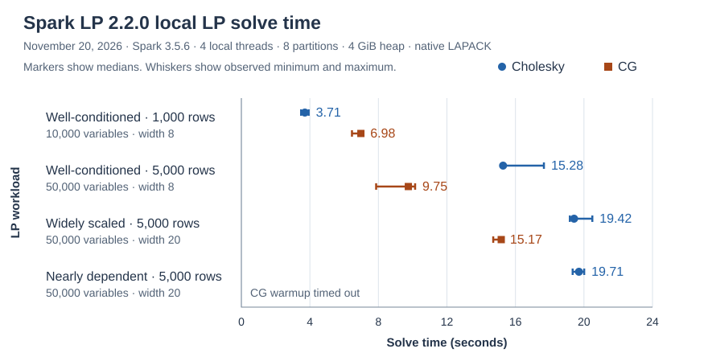
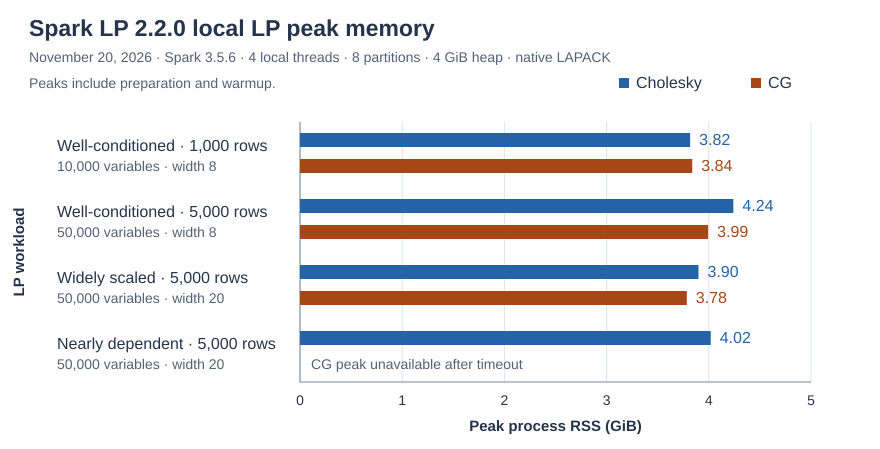
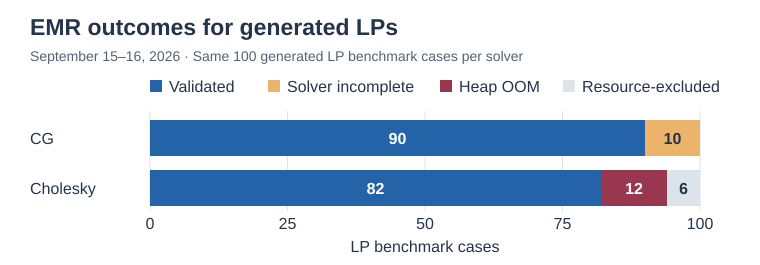
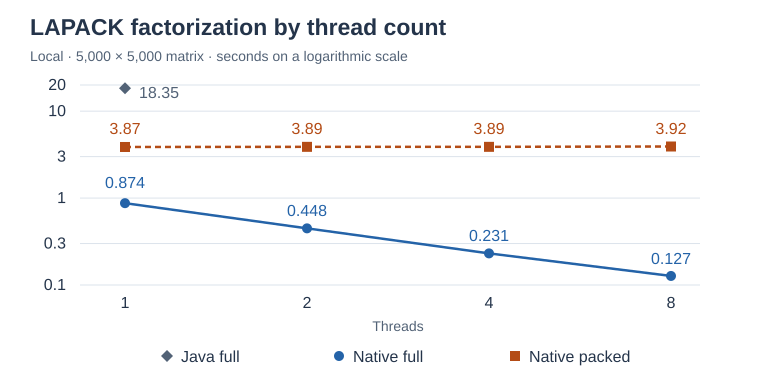

= Benchmarks

The https://bencher.dev/perf/spark-lp[Bencher dashboard] compares solve time, memory
and convergence across workloads. For commands and configuration, see
https://github.com/vbmacher/spark-lp/blob/master/benchmarks/README.md[Running and extending benchmarks].

Compare Cholesky and conjugate gradient (CG) on the same case, resources and testbed
(execution environment). Scenario names identify problem dimensions, density, conditioning,
tolerance, solver backend, CPU allocation, partitions and heap limits.

Check convergence before comparing time and memory. A missing time means no successful timing
was published. Heap limits describe configuration; memory measures report observed usage.

== September 2026 results

Cholesky was faster on small LPs and validated more of the difficult cases. CG was faster on
several large sparse LPs and solved the largest case, with 100,000 rows and 100 million variables.

The September 14–17 snapshot contains 375 published outcomes from 22 reports across eight
testbeds. Each outcome represents one benchmark configuration in a report. The total covers
local and EMR LPs, modelling workloads, LAPACK factorization, and Python and OpenCL checks,
including repeat runs. Of those outcomes, 309 include a validated solve time, 17 validated
without a published time, and 49 recorded no validated result. These measurements predate the
Spark LP 2.2.0 release. https://api.bencher.dev/v0/projects/spark-lp/reports?per_page=100[Published reports]

=== Local LP runtime and memory

On the width-8 series with four Spark threads and a 4 GiB heap, Cholesky was faster through
1,000 rows. At 5,000 rows, CG took 11.4 seconds and Cholesky took 156.0 seconds, a 13.6× speedup.
At 10,000 rows, CG took 9.3 seconds and the benchmark excluded Cholesky for memory. A separate
width-20 series favored CG starting at 2,500 rows. Observed peak process RSS was 3.8–4.1 GiB
across the width-8 runs shown below.
https://api.bencher.dev/v0/projects/spark-lp/reports/01a0b3e6-ca9f-79e3-8daf-9f6fd8e4adb4[Local LP results]

=== Distributed LPs on EMR

The September 15–16 campaign compared both solvers on the same 100 generated LP benchmark
cases. Cases varied matrix dimensions, nonzeros per row, coefficient or constraint structure,
random seed, solver tolerance, or driver heap. Each solver had four Spark executors with four
cores and 16 GiB heap each, and 16 Spark partitions. A validated case completed the warmup and
all five measured solves.
https://api.bencher.dev/v0/projects/spark-lp/reports/01a0b3e7-0270-7371-a298-5dbfabe1bdce[Initial campaign] ·
https://api.bencher.dev/v0/projects/spark-lp/reports/01a0b3e7-0d1e-7211-9585-315152905873[Resumed campaign]

[cols="1,3,1,1,1",options="header"]
|===
|Workload |LPs and settings |Cases per solver |CG validated |Cholesky validated
|Accuracy |1,000–6,000 rows at a tolerance of `1e-6`, with several conditioning patterns and seeds |21 |17 |21
|Conditioning |500 or 5,000 rows at `1e-8`, including well-conditioned, widely scaled, nearly dependent, and degenerate cases |24 |18 |24
|Dense matrices |100, 500, or 1,000 rows, with twice as many variables and dense rows |9 |9 |9
|Driver heap |Well-conditioned LPs with 1,000, 5,000, or 10,000 rows and an 8 GiB driver heap |9 |9 |9
|Sparse baseline |Well-conditioned LPs with 6,000 or 10,000 rows and 20 nonzeros per row |4 |4 |1
|Larger sparse LPs |20,000 or 50,000 rows, ten times as many variables, and 20 nonzeros per row |6 |6 |0
|Shape and sparsity |1,000, 5,000, or 10,000 rows, with 2×, 10×, or 50× as many variables and 5, 20, or 100 nonzeros per row |27 |27 |18
|*Total* | |*100* |*90* |*82*
|===

CG's 10 incomplete cases had widely scaled coefficients or nearly dependent rows and hit
iteration limits, numerical stalls, or timeouts. Cholesky ran out of JVM heap on 12 cases
at 10,000 rows with a 4 GiB driver heap. The benchmark excluded Cholesky on the six larger
sparse LPs under the same driver heap limit. CG solved those six in 43–56 seconds.

* On a matched 10,000-row wide case, CG took 176 seconds and Cholesky took 1,445 seconds.
  Peak driver RSS was 8.65 GiB for CG and 10.55 GiB for Cholesky. Cholesky solved all three
  5,000-row wide configurations where CG hit its iteration limit.
  https://api.bencher.dev/v0/projects/spark-lp/reports/01a0b3e7-0831-7442-bc3e-128fab57d029[Wide scaling] ·
  https://api.bencher.dev/v0/projects/spark-lp/reports/01a0b3e7-135b-73d2-9b37-8389dc2ee0d3[Wide scaling and largest CG run]
* At 100,000 rows and 100 million variables, CG validated in 337 seconds with 1,024 partitions
  and in 483 seconds with 128 partitions. The runs used different revisions, so the timings
  cannot isolate the effect of partition count. The published Cholesky outcome at this size
  has no validated timing.
  https://api.bencher.dev/v0/projects/spark-lp/reports/01a0b3e6-e115-7362-bddb-1b93536904b5[1,024 partitions] ·
  https://api.bencher.dev/v0/projects/spark-lp/reports/01a0b3e7-135b-73d2-9b37-8389dc2ee0d3[128 partitions] ·
  https://api.bencher.dev/v0/projects/spark-lp/reports/01a0b3e7-17ac-7e80-b53a-f5da570a5c4c[Cholesky outcome]
* With executor allocation fixed, 16 Spark partitions beat 32 and 64 on all three CG workloads
  in both sweeps. In one sweep, the 1,000-row dependent case took 219 seconds at 16 partitions
  and 360 seconds at 64. The published snapshot has no timed local 1/2/4-thread comparison.
  https://api.bencher.dev/v0/projects/spark-lp/reports/01a0b3e6-f981-78c1-802f-106ab417f439[First partition sweep] ·
  https://api.bencher.dev/v0/projects/spark-lp/reports/01a0b3e6-fdb8-7533-aa26-768f29e274c4[Second partition sweep]

=== LAPACK and BLAS

For a 5,000 × 5,000 matrix, full LAPACK factorization took 18.35 seconds in Java, 0.874 seconds
with one native thread, and 0.127 seconds with eight. Native packed factorization stayed near
3.9 seconds across thread counts. On the matched 5,000-row LP, native LAPACK cut Cholesky solve
time from 198.1 to 23.1 seconds. CG took 14.6 seconds with Java and 22.4 seconds with native BLAS.
https://api.bencher.dev/v0/projects/spark-lp/reports/01a0b3e7-238c-7061-afbc-a3a76f4b7362[Java baseline] ·
https://api.bencher.dev/v0/projects/spark-lp/reports/01a0b3e7-1f7a-7fe0-81e2-743ffa43d0f7[Native LAPACK] ·
https://api.bencher.dev/v0/projects/spark-lp/reports/01a0b3e7-2736-7480-8070-3bc4f1017359[Native BLAS]

=== Modelling and verification

Parallel-only MIP search roughly halved solve time on both knapsack fixtures. Full presolve
and supplied starts increased end-to-end time on the small fixtures tested. The eight published
QP outcomes and all three Python normal-system checks validated without timings. Six dense LP
outcomes validated on retry without timings, and none of the five OpenCL cases validated.
https://api.bencher.dev/v0/projects/spark-lp/reports/01a0b3e6-f09b-7e61-8187-f89912076bd5[Modelling workloads] ·
https://api.bencher.dev/v0/projects/spark-lp/reports/01a0b3e6-f59c-7a11-8da7-4f5329761e2a[Dense LP retry] ·
https://api.bencher.dev/v0/projects/spark-lp/reports/01a0b3e6-ecdc-7140-9dde-57cda3614a11[Python checks] ·
https://api.bencher.dev/v0/projects/spark-lp/reports/01a0b3e6-e8b4-7402-aea7-a13d7cf7a627[OpenCL checks]

Separate local smoke runs validated both LP backends, presolve, a supplied LP start, MIP,
factor-form QP, and a LAPACK kernel, with one measured attempt per case.

== Coverage

[cols="1,4",options="header"]
|===
|Suite |Purpose
|`smoke` |Fast correctness and pipeline check
|`scaling` |Increasing rows, columns and support width
|`parallelism` |Fixed problem with 1/2/4 local Spark threads
|`accuracy` |Density, conditioning, seed and tolerance stress cases
|`capabilities` |Presolve, warm starts, MIP policies and QP forms
|`kernels` |Packed/full LAPACK factorization without Spark
|`distributed` |Large LPs, partitions and executor allocation
|`full` |All supported cases except smoke; includes YARN workloads
|===

== Measures

[cols="1,4",options="header"]
|===
|Measure |Meaning
|`solve-seconds` |Median successful solve time in seconds; bounds are observed min/max, not confidence intervals
|`local/driver/executor-heap-bytes-max` |Observed peak used JVM heap, in bytes
|`local/driver/executor-rss-bytes-max` |Observed peak resident memory, in bytes; unavailable observations are omitted
|`cpus` |Configured local threads, total executor cores or native kernel threads. Measures allocation, not CPU utilization or partition count.
|`converged` |1: every attempt produced a validated solution; 0: failure, timeout, exclusion or incomplete execution
|===

Each scenario uses a fresh JVM, normally one warmup and five measured repetitions.
Linear-program (LP) timing excludes generation, preparation and independent validation.
Modelling-API (DSL) timing includes compilation, presolve, search and start preparation.
Kernel timing covers factorization only. Every successful scenario must pass correctness
checks. Residuals and iteration counts are not Bencher measures. Failed scenarios publish no partial timing.

Memory peaks cover the worker application, including preparation and warmup.
Driver/local sampling runs every 20 ms; executor peaks come from Spark telemetry.
Executor values are the largest observed on one executor, not a cluster-wide sum.
Missing historical memory or CPU observations are never estimated. Parallel speedup
and efficiency are printed locally, not added to the primary measures.

== Testbeds

Testbed names are derived automatically from the execution environment.
Native LAPACK and BLAS use `-native-lapack` and `-native-blas` suffixes.
