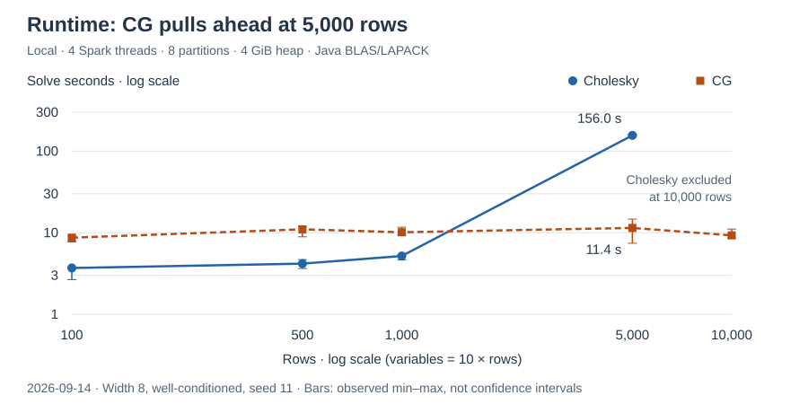
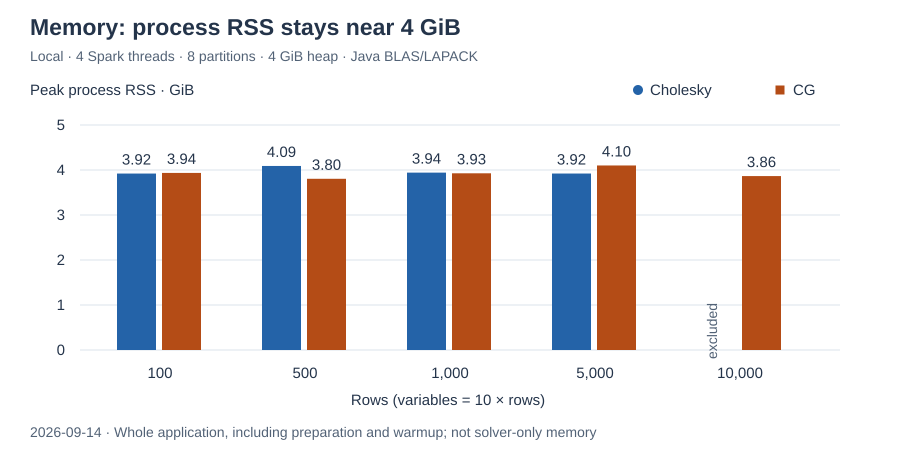

= spark-lp documentation
:toc: left
:source-highlighter: highlightjs

spark-lp solves linear, mixed-integer linear and continuous convex quadratic optimization models
using Apache Spark. Its Scala API compiles model declarations into sparse numerical data. A
https://epubs.siam.org/doi/10.1137/0802028[Mehrotra predictor-corrector interior-point method]
solves continuous models; https://doi.org/10.2307/1910129[branch-and-bound] handles integer variables.

== Guides

[cols="1,3",options="header"]
|===
|Guide |Contents
|xref:usage.adoc[Using spark-lp]
|Installation, modelling, solving, diagnostics, interchange and tuning.

|xref:algorithm.adoc[How spark-lp solves a model]
|Equality-form compilation, interior-point solving, backend selection, integer search and certificates.

|xref:benchmarks.adoc[Benchmarks]
|Benchmark coverage, measures, testbeds and interpretation.
|===

== Performance

The https://bencher.dev/perf/spark-lp[live benchmark dashboard] tracks solve time,
memory and convergence. The charts below compare the Cholesky and conjugate-gradient
linear-system solvers. See xref:benchmarks.adoc[the benchmark guide] for measures and comparison rules.

== Project

Source code, releases and issue tracking are available in the
https://github.com/vbmacher/spark-lp[spark-lp GitHub repository].
